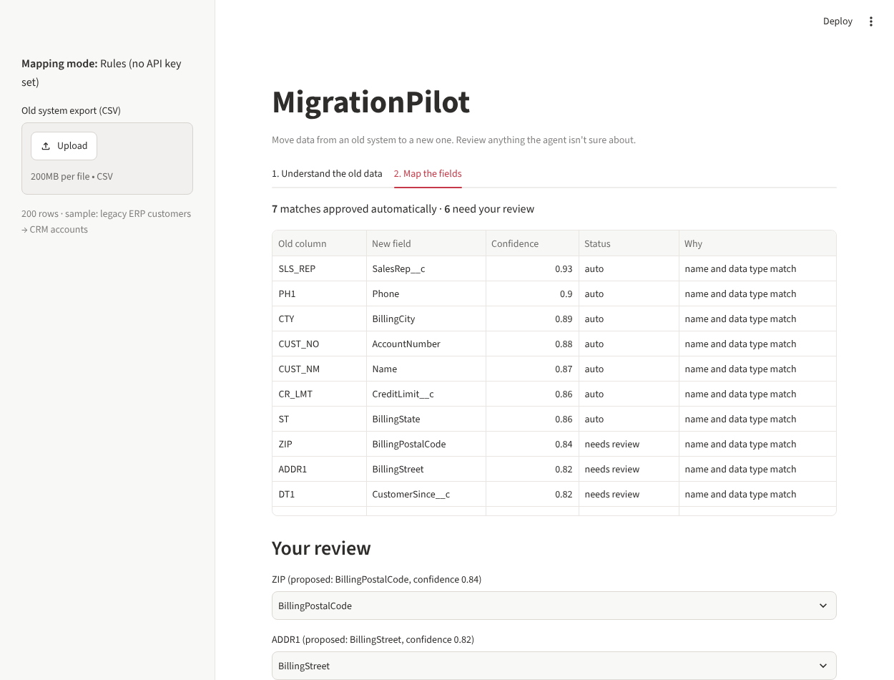

# MigrationPilot

An AI agent that moves data between business systems, checks that nothing gets lost, and improves every time a human corrects it.



## Why

Moving data from an old system to a new one, like an old ERP into a CRM, is slow and risky. Column names are cryptic (`CUST_NM`, `DT1`), the data is messy, and one mistake can lose records. MigrationPilot does the tedious parts and asks a human whenever it isn't sure.

## How it works

1. **Understand the old data.** It scans every column, figures out what kind of data it holds, and flags problems like duplicate IDs, bad emails, and ZIP codes missing their leading zeros.
2. **Map the fields.** It matches old columns to new fields with a confidence score. Strong matches are approved automatically. Uncertain ones go to a human.
3. **Learn from corrections.** Every human decision is saved, so the agent can learn from its mistakes.

## Roadmap

- [x] **Phase 1:** scan the old data, map fields with confidence scores, human review
- [ ] **Phase 2:** generate conversion code and tests, dry run, migrate with undo, sign-off report
- [ ] **Phase 3:** self-improvement loop that learns from corrections, with safety checks and a benchmark

## Tech stack

Python, Azure OpenAI, LangChain, Streamlit, Docker, GitHub Actions

## Run it locally

```bash
pip install -r requirements-dev.txt
streamlit run app.py
```

It works without an API key using rule-based matching. To use AI matching, copy `.env.example` to `.env` and add your Azure OpenAI or OpenAI key.

## Testing

```bash
pytest
```

GitHub Actions runs the tests and builds the Docker image on every push.
