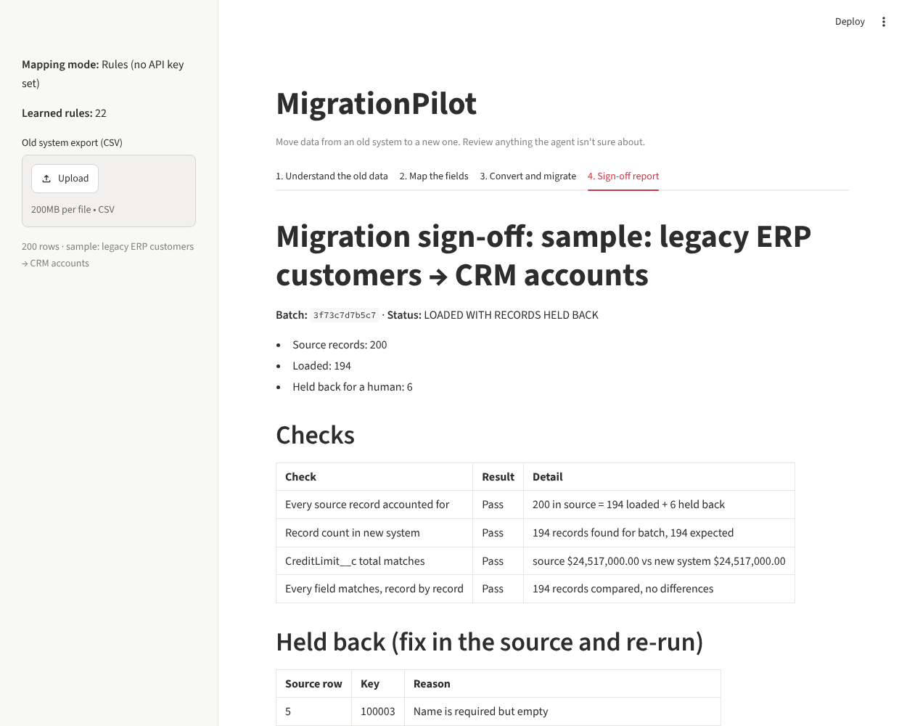

# MigrationPilot

An AI agent that moves data between business systems, checks that nothing gets lost, and improves every time a human corrects it.



## Why

Moving data from an old system to a new one, like an old ERP into a CRM, is slow and risky. Column names are cryptic (`KUNNR`, `DT1`), the data is messy, and one mistake can lose records. MigrationPilot does the tedious parts and asks a human whenever it isn't sure.

## How it works

1. **Understand the old data.** Scans every column and flags problems like duplicate IDs, bad emails, and ZIP codes missing their leading zeros.
2. **Map the fields.** Matches old columns to new fields with a confidence score. Uncertain matches go to a human.
3. **Write the conversion code.** Generates readable conversion code plus tests, so you can see exactly how every field is converted.
4. **Dry run, then migrate.** Practices first, then loads everything in one batch that can be undone. Bad records are held back with a reason instead of being dropped.
5. **Prove nothing was lost.** Compares record counts, money totals, and every field of every record, then writes a sign-off report.
6. **Learn from corrections.** Turns human corrections into rules, keeps only the rules that measurably help, and blocks any rule that fails a safety check.

## Results

On later exports from systems it had already learned from, the fields needing human review dropped from **27 to 5**, and accuracy went from **91.4% to 100%**. On a system it had never seen, nothing changed, so learning didn't hurt. One deliberately wrong correction was blocked by the safety check.

Data and human reviews are simulated. See [the full benchmark and its limits](docs/BENCHMARK.md).

## Tech stack

Python, Azure OpenAI, LangChain, SQLite, Streamlit, Docker, GitHub Actions

## Run it locally

```bash
pip install -r requirements-dev.txt
streamlit run app.py
```

Works without an API key using rule-based matching. For AI matching, copy `.env.example` to `.env` and add your Azure OpenAI or OpenAI key.

## Testing

```bash
pytest                              # 38 tests
python -m migration_pilot.benchmark # re-runs the benchmark
```

GitHub Actions runs the tests and builds the Docker image on every push.
